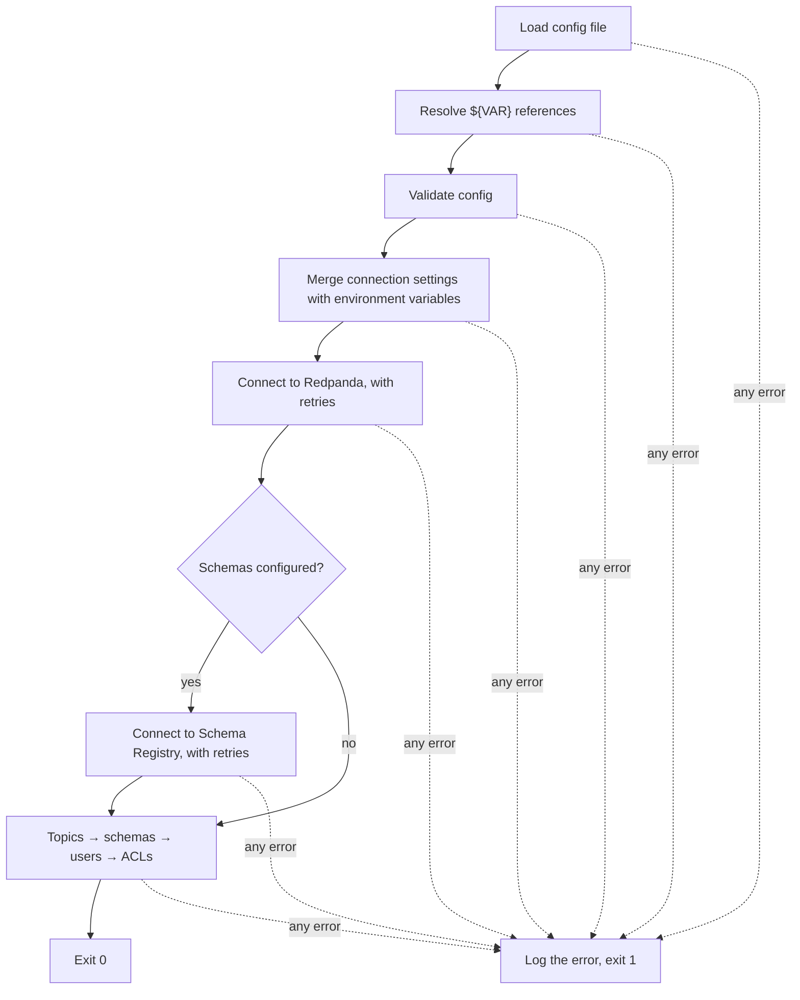

# How it works

After reading this you can predict what a run of the provisioner will change in your cluster,
what it will leave alone, and where to look when it fails.

The [getting started guide](getting-started.md) showed *what* the provisioner does. This page
explains the model behind a run, so its behaviour holds no surprises in production.

## A run, from start to finish

Every run goes through the same stages and stops at the first error:



1. **Load the config.** The YAML file is parsed, `${VAR}` references are resolved, and the
   config is validated. A broken config stops the run **before it connects to anything**, so
   it never leaves a half-provisioned cluster. Validation reports the first problem it finds,
   with the field's path, for example
   `loading configuration: validating config: users[0].mechanism: is required`. Fix it and run again
   to see the next one.
2. **Merge connection settings.** Broker and Schema Registry settings left empty in YAML are
   filled from environment variables (see [below](#yaml-or-environment-variable)).
3. **Connect** to Redpanda, and to the Schema Registry only if the config has schemas. Both
   wait with backoff until the target answers.
4. **Provision** topics, schemas, users and ACLs in that order.
5. **Exit** with code `0` on success or `1` on the first error. Exit codes and how to read the
   error are covered in [Deployment](deployment.md).

## The provisioning order

The four resource types are applied in a fixed order, and each entry in config order:

| # | Step | Why here |
|---|---|---|
| 1 | **Topics** | Schemas and ACLs usually refer to them. |
| 2 | **Schemas** | Registered after the topics they describe exist. |
| 3 | **Users** | Created before the ACLs that name them. |
| 4 | **ACLs** | Last, so a service gets its permissions only once everything else is in place. |

The order is for readability; the broker does not require it. An ACL can name a user or topic
that does not exist, and a schema subject is not tied to a topic.

### Stop at the first error

The provisioner stops at the first entry that fails. Everything applied before that entry
stays applied, and nothing after it runs. In this run the schema file is missing, so the topic
`invoices` is created, the schema fails, and the user `invoices-service` is never created:

```text
{"level":"INFO","msg":"Starting provisioning"}
{"level":"INFO","msg":"Creating topic","topic":"invoices","partitions":3,"replication_factor":1}
{"level":"ERROR","msg":"redpanda-provisioner failed","error":"provisioning: provisioning schema \"invoices-value\": reading schema file \"/config/schemas/invoices.avsc\": open /config/schemas/invoices.avsc: no such file or directory"}
```

(Trimmed: start-up lines and the `time` field are left out.) There is no state to clean up.
Fix the cause and run again: the topic is found and compared, and the run continues where it
stopped. Note that schema files are read only at this point, not during validation, so a wrong
`file` path shows up after the topics have been applied.

## What each run changes

The provisioner reconciles what is **in** the config and ignores everything else. This is what
a run does with each resource type:

| Resource | Created when missing | Reconciled on every run | Never touched |
|---|---|---|---|
| **Topic** | yes, with `partitions` and `replication_factor` (each `1` when omitted) and all `config` keys | partitions increased if the config asks for more; each `config` key listed in YAML compared as a string and set if it differs | partitions are never decreased (a warning is logged); the replication factor of an existing topic; `config` keys not listed in YAML |
| **Schema** | yes, registered as a new subject | registered again: same content returns the existing ID, changed content becomes a new version if the registry's compatibility rule allows it; `compatibility` set if given and different | earlier versions; the subject's compatibility level when `compatibility` is not set |
| **User** | yes | upserted: password, mechanism and iterations are set on every run | — |
| **ACL** | yes | requested again; the broker keeps one binding per principal, resource, operation and permission | ACL bindings not in the config |

Two consequences are worth knowing:

- **Users get their password set on every run.** If another system rotates a user's password,
  the next run sets it back to the configured value. See
  [Rotate a service user's password](howto/rotate-a-user-password.md).
- **Some topic settings are rewritten on every run.** Redpanda does not report every setting
  back. `min.insync.replicas` on Redpanda `v26.1.6` is one of them, so every run logs
  `"msg":"Updating topic config",…,"key":"min.insync.replicas","current":"","desired":"1"` and
  sets it again. That is harmless.

To change a topic, see [Change a topic's settings](howto/change-topic-settings.md) and
[Add partitions to a topic](howto/add-partitions-to-a-topic.md). For schemas, see
[Evolve a schema safely](howto/evolve-a-schema.md): the compatibility level is set *after* the
new schema is registered, so relaxing the level and registering a schema that only the relaxed
level accepts needs two runs.

## Additive by design

The provisioner never deletes anything. Removing an entry from the config has no effect on the
cluster:

| You remove… | What happens |
|---|---|
| a topic | Nothing. The topic and its data stay. |
| a schema entry | Nothing. The subject and all its versions stay. |
| `compatibility` from a schema | Nothing. The subject keeps its current level. |
| a key from a topic's `config` | Nothing. The topic keeps the last value set. |
| a user | Nothing. The user can still log in. |
| an ACL, or an operation from an ACL's `operations` | Nothing. The binding stays. |

This is deliberate: a typo or a forgotten line must not delete a topic's data or lock a service
out. The other side is that the config describes a **minimum**, not the exact state of the
cluster. Removing a user or an ACL is a manual step with `rpk`; see
[Revoke an ACL or remove a user](howto/revoke-access.md).

## Strategy: `update` or `create`

`strategy` decides what happens to **topics that already exist**. It has no effect on schemas,
users or ACLs, which are always handled as described above.

- **`update`** (default): reconcile the topic's partitions and `config` keys.
- **`create`**: create the topic if it is missing, otherwise leave it exactly as it is.

Set it at the top level for all topics and override it per topic. The values are lowercase:

```yaml
strategy: update          # default for all topics; "update" if omitted

topics:
  - name: orders
    partitions: 3           # was 6
    replication_factor: 1
  - name: audit-log
    partitions: 6           # was 3, but strategy: create
    replication_factor: 1
    strategy: create
```

Run against a cluster where `orders` has 6 partitions and `audit-log` has 3, neither topic
changes, for different reasons:

```text
{"level":"INFO","msg":"Starting provisioning"}
{"level":"WARN","msg":"Topic has more partitions than configured (cannot decrease)","topic":"orders","current":6,"desired":3}
{"level":"INFO","msg":"Skipping existing topic (strategy=create)","topic":"audit-log"}
{"level":"INFO","msg":"Provisioning complete"}
```

(Trimmed: start-up lines and the `time` field are left out.) The partition warning does not
fail the run. Use `create` for topics that someone else tunes after creation, so the
provisioner does not overwrite their changes.

## YAML or environment variable

The connection settings (`broker` and `schema_registry`) can come from the YAML file or from
environment variables. For each field, a **non-empty YAML value wins**; when the YAML value is
empty or missing, the environment variable is used:

| YAML field | Environment variable | When both are empty |
|---|---|---|
| `broker.addresses` | `REDPANDA_BROKERS` (comma-separated) | `localhost:9092` |
| `broker.sasl.username` / `password` | `REDPANDA_SASL_USERNAME` / `REDPANDA_SASL_PASSWORD` | no SASL |
| `broker.sasl.mechanism` | `REDPANDA_SASL_MECHANISM` | `SCRAM-SHA-256` |
| `broker.tls.enabled` | `REDPANDA_TLS_ENABLED` | TLS off |
| `schema_registry.url` | `SCHEMA_REGISTRY_URL` | none; required when schemas are configured |
| `schema_registry.username` / `password` | `SCHEMA_REGISTRY_USERNAME` / `SCHEMA_REGISTRY_PASSWORD` | no authentication |

Three details:

- `broker.tls.enabled` set in YAML wins in both directions: `false` in YAML turns TLS off even
  if `REDPANDA_TLS_ENABLED=true`.
- A `${VAR:-}` reference that resolves to an empty string counts as empty, so the environment
  variable from the table is used.
- A username needs its password from the same source. Config validation rejects a YAML
  username without a YAML password (`broker.sasl: username and password must both be set or
  both be empty`), and the merged values are checked again before connecting.

The full list of environment variables is in [Deployment](deployment.md).

## Environment variables inside the file

Any string field in the config can contain `${VAR}` or `${VAR:-default}`; the reference is
replaced with the variable's value when the file is loaded. If a variable is not set and has
no default, the run fails before connecting and lists every missing variable with its field
path. A variable that is set but empty wins over the default, unlike in a shell. Numbers and
booleans (`partitions`, `replication_factor`, `iterations`, `tls.enabled`) can't use
references. The rules are in [Configuration reference](configuration.md); keeping passwords
out of the file is covered in [Keep passwords out of the config file](howto/manage-secrets.md).

## Waiting for Redpanda and the Schema Registry

The provisioner usually starts at the same time as the broker, so it waits instead of failing
on the first refused connection. Redpanda and the Schema Registry are each tried with the same
policy:

- first retry after 1 second, then the delay doubles (2, 4, 8, 16 seconds) up to a cap of 30
  seconds,
- at most 15 retries,
- a timeout of 5 minutes **per target**. The Schema Registry gets its own 5 minutes after
  Redpanda has answered, so a run can wait up to about 10 minutes before it fails.

The 5-minute timeout fires before the 15 retries run out: the delays add up to more than 5
minutes after about 14 retries. A run that never reaches the broker therefore ends with a
timeout error, which does not contain the reason:

```text
connecting to Redpanda: connection timeout: context deadline exceeded
```

The reason is in the `WARN` line logged before each retry, in its `error` field:

```text
{"level":"INFO","msg":"Connecting to Redpanda","brokers":["localhost:31499"]}
{"level":"WARN","msg":"Redpanda not ready, retrying","attempt":1,"max_retries":15,"delay":1000000000,"error":"unable to dial: dial tcp [::1]:31499: connect: connection refused"}
{"level":"WARN","msg":"Redpanda not ready, retrying","attempt":2,"max_retries":15,"delay":2000000000,"error":"unable to dial: dial tcp [::1]:31499: connect: connection refused"}
{"level":"WARN","msg":"Redpanda not ready, retrying","attempt":3,"max_retries":15,"delay":4000000000,"error":"unable to dial: dial tcp [::1]:31499: connect: connection refused"}
…
```

(Trimmed: the `time` field is left out.) `delay` is in nanoseconds. The Schema Registry logs
`Schema Registry not ready, retrying` in the same format; its check is a `GET /subjects`
request, so any answer other than `200` shows up as
`"error":"schema registry returned status <code>"`.

Every error is retried, including wrong credentials and wrong TLS settings. A configuration
mistake in the connection settings therefore costs you the full 5 minutes. When a run hangs at
`Connecting to …`, read the `error` field of the first `WARN` line instead of waiting for the
timeout.

## The Schema Registry is optional

The provisioner connects to the Schema Registry only when the config has at least one entry
under `schemas`. Without schemas, it does not contact the registry, even if a URL is set:

```text
{"level":"INFO","msg":"Connected to Redpanda","brokers":["localhost:31492"]}
{"level":"INFO","msg":"Skipping Schema Registry connection — no schemas configured","url":"http://localhost:31481"}
```

(Trimmed: the `time` field is left out.) So a config with only topics, users and ACLs works
against a cluster without a Schema Registry, and an unreachable registry does not hold up such
a run for 5 minutes. With schemas configured but no URL, the run fails before connecting:
`schema registry URL required when schemas are configured (set schema_registry.url or SCHEMA_REGISTRY_URL)`.

## No dry-run

The provisioner has no dry-run or validate-only mode, and no command-line flags. Every run that
gets past validation applies changes. To try a config change:

- run it against a throwaway Redpanda first, for example the stack from
  [Getting started](getting-started.md),
- rely on validation for typos in values: an invalid `strategy`, `mechanism`, `operations`
  entry and the like fails the run before it connects.

Unknown or misspelt **keys** are not caught: the YAML parser ignores them, so `replication_factr: 3`
is silently dropped and the topic is created with a replication factor of `1`. The
[Configuration reference](configuration.md) lists the exact field names.

## Logs

Logs are JSON lines on stdout, one per action, as in the examples on this page.
Passwords of the users you provision never appear in them. `LOG_LEVEL=debug` adds lines such as `Topic config up to date`;
`LOG_LEVEL=warn` shows only warnings and errors. See [Deployment](deployment.md).

## Next steps

- [Configuration reference](configuration.md) lists every field and its validation rules.
- [Deployment](deployment.md) covers the image, environment variables, broker permissions and
  exit codes.
- [FAQ](faq.md) answers the questions that come up once the provisioner runs in production.
