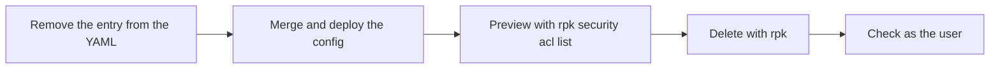

# Revoke an ACL or remove a user

After this a service has lost a right it should no longer have, or its login is gone, and the
next provisioning run doesn't bring either back.

## When you need this

A service no longer writes to a topic, a service is retired, or a credential has to be cut off.
The provisioner only adds: deleting an entry from the YAML leaves the ACL or user in the
cluster, so you remove it by hand with `rpk`.

Deletion takes effect immediately and can't be undone with a command: a service that still
needs the access fails at once, and a deleted user's password is gone. Restoring means
putting the entry back into the YAML and running the provisioner again, which recreates the
ACL or the user with the password from your secret store. Check who uses the access before you
start.

## What you need to know first

- **The provisioner never deletes.** It creates users and ACLs that are missing and leaves
  everything else alone, so it can't tell an ACL you removed from the YAML from one somebody
  else created. See [How it works](../concepts.md).
- **ACL filters.** `rpk security acl delete` deletes every ACL that matches its filters, and a
  filter you leave out matches everything: no `--operation` means all operations, no resource
  flag means all resources. See
  [rpk security acl delete](https://docs.redpanda.com/current/reference/rpk/rpk-security/rpk-security-acl-delete/)
  in the Redpanda docs.
- **Users and ACLs are separate.** Deleting a user does not delete its ACLs. A new user with the
  same name later gets all of them again.
- **Admin rights.** Both commands need an account that may manage users and ACLs, such as the
  provisioner's admin account
  ([Set up the provisioner's admin account](set-up-the-provisioner-admin-account.md)).

The names `orders-producer`, `orders` and `billing-service` below are placeholders.



## Steps

### 1. Remove the entry from the YAML first

Delete the ACL entry, or the user and all of its ACL entries, from the config and deploy that
change before you touch the cluster. The order matters: if the entry is still in the YAML, the
next provisioning run creates it again. This run happened after an ACL was deleted with `rpk`
but left in the YAML (trimmed to `msg` and its keys):

```text
{"level":"INFO","msg":"Ensuring ACL","principal":"User:orders-producer","operations":["write","describe"],"resource_type":"topic","resource_name":"orders","pattern":"literal","permission":"allow"}
```

and the ACL was back:

```console
$ rpk security acl list --allow-principal User:orders-producer -X user=<admin-user> -X pass='<admin-password>' -X sasl.mechanism=SCRAM-SHA-256
PRINCIPAL             HOST  RESOURCE-TYPE  RESOURCE-NAME  RESOURCE-PATTERN-TYPE  OPERATION  PERMISSION  ERROR
User:orders-producer  *     TOPIC          orders         LITERAL                DESCRIBE   ALLOW
User:orders-producer  *     TOPIC          orders         LITERAL                WRITE      ALLOW
```

### 2. Preview what the delete will match

Run `rpk security acl list` with the filters you are going to delete with. Give the principal,
the resource, the pattern type and the operations explicitly, so the filter can't match more
than the YAML entry you removed:

```console
$ rpk security acl list --allow-principal User:orders-producer --topic orders \
    --resource-pattern-type literal --operation write,describe \
    -X user=<admin-user> -X pass='<admin-password>' -X sasl.mechanism=SCRAM-SHA-256
PRINCIPAL             HOST  RESOURCE-TYPE  RESOURCE-NAME  RESOURCE-PATTERN-TYPE  OPERATION  PERMISSION  ERROR
User:orders-producer  *     TOPIC          orders         LITERAL                DESCRIBE   ALLOW
User:orders-producer  *     TOPIC          orders         LITERAL                WRITE      ALLOW
```

For a prefixed entry use `--resource-pattern-type prefixed`; for a group, transactional ID or
the cluster use `--group <name>`, `--transactional-id <name>` or `--cluster` instead of
`--topic`.

### 3. Delete the ACL

Run the same command as `rpk security acl delete`. In a terminal it prints the matching ACLs
and asks `Confirm deletion of the above matching ACLs? (Y/n)`; `--no-confirm` skips the
question, which is what scripts need. It prints the ACLs it deleted:

```console
$ rpk security acl delete --allow-principal User:orders-producer --topic orders \
    --resource-pattern-type literal --operation write,describe --no-confirm \
    -X user=<admin-user> -X pass='<admin-password>' -X sasl.mechanism=SCRAM-SHA-256
PRINCIPAL             HOST  RESOURCE-TYPE  RESOURCE-NAME  RESOURCE-PATTERN-TYPE  OPERATION  PERMISSION  ERROR
User:orders-producer  *     TOPIC          orders         LITERAL                DESCRIBE   ALLOW
User:orders-producer  *     TOPIC          orders         LITERAL                WRITE      ALLOW
```

`--dry` does not replace the preview in step 2: with the `rpk` in the Redpanda v26.1.6 image it printed the matches and then
asked for confirmation anyway.

### 4. To remove a user: delete its ACLs, then the user

Delete all ACLs of the principal by leaving out every resource and operation filter. Run the
`list` form first, as in step 2, to see what that covers:

```console
$ rpk security acl delete --allow-principal User:billing-service --no-confirm \
    -X user=<admin-user> -X pass='<admin-password>' -X sasl.mechanism=SCRAM-SHA-256
PRINCIPAL             HOST  RESOURCE-TYPE  RESOURCE-NAME  RESOURCE-PATTERN-TYPE  OPERATION  PERMISSION  ERROR
User:billing-service  *     GROUP          billing        LITERAL                READ       ALLOW
User:billing-service  *     TOPIC          orders         LITERAL                DESCRIBE   ALLOW
User:billing-service  *     TOPIC          orders         LITERAL                READ       ALLOW
```

Then delete the user:

```console
$ rpk security user delete billing-service -X user=<admin-user> -X pass='<admin-password>' -X sasl.mechanism=SCRAM-SHA-256
Deleted user "billing-service".
```

Deleting the user alone leaves its ACLs behind. Captured after `rpk security user delete
billing-service` without step 4's ACL delete:

```console
$ rpk security acl list --allow-principal User:billing-service -X user=<admin-user> -X pass='<admin-password>' -X sasl.mechanism=SCRAM-SHA-256
PRINCIPAL             HOST  RESOURCE-TYPE  RESOURCE-NAME  RESOURCE-PATTERN-TYPE  OPERATION  PERMISSION  ERROR
User:billing-service  *     GROUP          billing        LITERAL                READ       ALLOW
User:billing-service  *     TOPIC          orders         LITERAL                DESCRIBE   ALLOW
User:billing-service  *     TOPIC          orders         LITERAL                READ       ALLOW
```

## Check that it works

The captures ran inside a Redpanda v26.1.6 container with SASL and authorization enabled
(`docker exec <container> rpk …`).

After step 3, the user can still log in but no longer write:

```console
$ echo order-2 | rpk topic produce orders -X user=orders-producer -X pass='<orders-producer-password>' -X sasl.mechanism=SCRAM-SHA-256
unable to produce record: TOPIC_AUTHORIZATION_FAILED: Not authorized to access topics: [Topic authorization failed.]
```

After deleting a user, its login fails:

```console
$ rpk topic list -X user=orders-producer -X pass='<orders-producer-password>' -X sasl.mechanism=SCRAM-SHA-256
unable to list topics: unable to request metadata: SASL_AUTHENTICATION_FAILED: SASL Authentication failed.: SASL authentication failed: security: Invalid credentials
```

`rpk security user list` no longer shows it, and `rpk security acl list --allow-principal
User:<name>` prints only the header line. Then run the provisioner once more and check that its
log has no `Ensuring SCRAM user` or `Ensuring ACL` line for what you removed.

## Pitfalls

- **The access comes back.** The entry is still in some config the provisioner runs with: a
  second environment's file, an older image of the config, another team's config. Step 1
  first, everywhere.
- **A filter that matches too much.** Leaving out `--operation` or the resource flag widens the
  delete to everything of that principal; leaving out the principal widens it to everyone.
  Always run the `list` form with identical flags first.
- **Deny entries.** ACLs created with `permission: deny` are matched by `--deny-principal`, not
  `--allow-principal`.
- **The user still works after removing its ACLs.** A user without ACLs can still log in; it
  only gets authorization errors. Delete the user too if the login itself must go.
- **Not sure the service is cut off.** Look for `TOPIC_AUTHORIZATION_FAILED`,
  `GROUP_AUTHORIZATION_FAILED` or `SASL_AUTHENTICATION_FAILED` in the service's logs.

## Further reading

- [How it works](../concepts.md) for what the provisioner reconciles and what it never touches.
- [Rotate a service user's password](rotate-a-user-password.md) if the goal is to cut off a
  leaked password but keep the service running.
- Redpanda docs: [rpk security acl delete](https://docs.redpanda.com/current/reference/rpk/rpk-security/rpk-security-acl-delete/)
  and [Configure Access Control Lists](https://docs.redpanda.com/current/manage/security/authorization/acl/).
