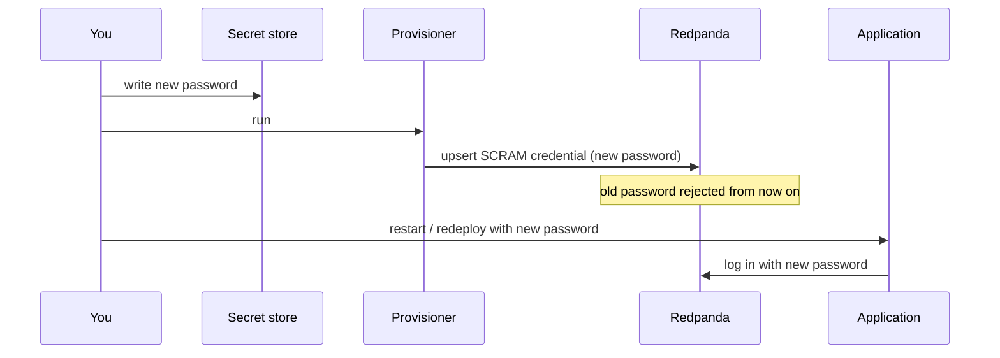

# Rotate a service user's password

After this you can change the password of a service user the provisioner manages, and you know
when the old password stops working so you can switch your clients at the right moment.

## When you need this

A service user's password has to change: a scheduled rotation, a leaked secret, or someone left
the team. The user is declared under `users:` in your config file, and its password comes from
an environment variable as described in [Keep passwords out of the config file](manage-secrets.md).

## What you need to know first

**SCRAM users.** Redpanda stores service users as SCRAM (Salted Challenge Response
Authentication Mechanism) credentials: a salted hash of the password for one mechanism
(`SCRAM-SHA-256` or `SCRAM-SHA-512`). A user has exactly one password; there is no second,
"next" password. See [How it works](../concepts.md).

**The password is set on every run.** For each entry under `users:`, the provisioner sends an
upsert that creates the user or overwrites its credential, whether or not the password changed.
`strategy` does not apply to users. So rotating is: change the secret, run the provisioner.

**No overlap window.** The moment the run sets the new password, the old one is gone. A client
that logs in with the old password after that point gets
`SASL_AUTHENTICATION_FAILED: … Invalid credentials`. Plan the client switch around that moment.

**Order of work.** The provisioner handles topics, then schemas, then users, then ACLs, and stops
at the first error. If a topic or schema step fails, the password is not changed in that run.

This is the sequence for a rotation:



## Steps

### 1. Decide how clients switch

Choose one of two approaches before you touch the secret:

- **Short gap (one user).** Rotate the password, then restart the clients right after. Between
  the provisioner run and the restart, new logins with the old password fail. Clients that
  reconnect in that window see authentication errors and must retry.
- **No gap (two users).** Add a second user, for example `orders-service-2026-11`, with its own
  password and the same ACL entries. Deploy the clients with the new user, then remove the old
  user as described in [Revoke an ACL or remove a user](revoke-access.md). Removing a user from
  the config file does not delete it; the provisioner never deletes users.

The rest of this guide covers the short-gap approach.

### 2. Write the new password into the secret

Change only the value of the variable that `users[].password` references. In Docker Compose
with an env file:

```console
$ printf 'ORDERS_SERVICE_PASSWORD=%s\n' "$(openssl rand -hex 24)" > provisioner.env
```

In Kubernetes, update the key in the Secret the Job reads, for example:

```console
$ kubectl create secret generic redpanda-provisioner-credentials \
    --from-literal=REDPANDA_ADMIN_USERNAME=admin \
    --from-literal=REDPANDA_ADMIN_PASSWORD=<admin-password> \
    --from-literal=ORDERS_SERVICE_PASSWORD=<new-orders-service-password> \
    --dry-run=client -o yaml | kubectl apply -f -
```

The config file does not change.

### 3. Run the provisioner

Run it the way you always do: `docker compose run --rm redpanda-provisioner`, or recreate the
Job as in [Run the provisioner as a Kubernetes Job](run-as-a-kubernetes-job.md). The user lines
are the moment the password changes:

```text
{"time":"2026-11-15T17:59:32.686161843+01:00","level":"INFO","msg":"Ensuring SCRAM user","username":"orders-service","mechanism":"SCRAM-SHA-256","iterations":4096}
{"time":"2026-11-15T17:59:32.689156359+01:00","level":"INFO","msg":"SCRAM user ensured","username":"orders-service"}
```

The new password is not printed; the log never contains passwords.

### 4. Restart the clients with the new password

Restart or redeploy everything that logs in as this user so it reads the new secret. Do it
immediately after step 3; this is the gap from step 1.

## Check that it works

Log in with the old and the new password. The output below was captured on a throwaway
Redpanda v26.1.6 container with SASL and authorization enabled; `rpk` (Redpanda's CLI) ran
inside the container. The commands only read topic metadata, so they are safe in any
environment.

Before the rotation, the old password works:

```console
$ rpk topic list -X brokers=<broker> -X user=orders-service -X pass=<old-password> -X sasl.mechanism=SCRAM-SHA-256
NAME    PARTITIONS  REPLICAS
orders  6           1
```

After the provisioner run, the old password fails at once and the new one works:

```console
$ rpk topic list -X brokers=<broker> -X user=orders-service -X pass=<old-password> -X sasl.mechanism=SCRAM-SHA-256
unable to list topics: unable to request metadata: SASL_AUTHENTICATION_FAILED: SASL Authentication failed.: SASL authentication failed: security: Invalid credentials
$ rpk topic list -X brokers=<broker> -X user=orders-service -X pass=<new-password> -X sasl.mechanism=SCRAM-SHA-256
NAME    PARTITIONS  REPLICAS
orders  6           1
```

`rpk topic list` shows only topics the user may describe; `orders` appears because the user has
a `describe` ACL on it.

## Pitfalls

- **Changing the password outside the provisioner doesn't stick.** If someone sets a new
  password with `rpk security user update`, the next provisioner run sets it back to the value
  in your secret. Rotate through the secret only.
- **An empty secret stops the run.** If the variable is set but empty, validation fails with
  `users[0].password: is required` and nothing changes, not even topics. See
  [Keep passwords out of the config file](manage-secrets.md).
- **A failed earlier step skips the rotation.** Topics and schemas run first. If one of them
  fails, the run exits with code 1 before it reaches the users, and the old password still works.
- **Changing `mechanism` also cuts off the old one.** On Redpanda v26.1.6, switching a user
  from `SCRAM-SHA-256` to `SCRAM-SHA-512` replaced the credential: logins with SCRAM-SHA-256
  failed afterwards with `Invalid credentials`. Clients then have to change both the mechanism
  and the password at the same moment, so plan a mechanism change like a rotation.
- **Rotating the provisioner's own login.** The admin account the provisioner connects with is
  usually not under `users:`. Change it in Redpanda first, then update the secret the provisioner
  reads; see [Set up the provisioner's admin account](set-up-the-provisioner-admin-account.md).

## Further reading

- [Keep passwords out of the config file](manage-secrets.md).
- [Revoke an ACL or remove a user](revoke-access.md).
- [How it works](../concepts.md) for the order of steps and what is never deleted.
- [Redpanda: configure authentication (SASL/SCRAM)](https://docs.redpanda.com/current/manage/security/authentication/).
- The code that sets the password: [`internal/provisioner/users.go`](../../internal/provisioner/users.go).
